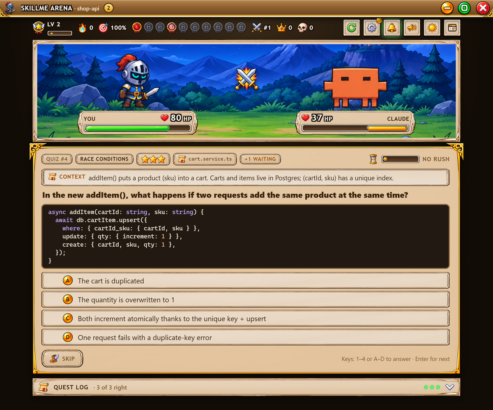

# SkillMe: don't just wait for the AI, keep up with it<br>Not for vibe coders

While your AI writes code, SkillMe pops up **short quizzes about what it is writing**.
Two progress bars race:

- **You:** how well you understand the code the AI generated (100% = you understand everything it wrote).
- **AI:** how well the AI knows your codebase. It grows as the AI reads and writes files, and **drops every time you catch it making a mistake**.

When you miss a question, you get the right answer, the reason, and a mini-lesson on the technique.
You earn XP, streaks, levels and badges along the way. Your understanding of the project grows instead of rotting while you wait.



## Who it's for

**SkillMe is not for vibe coders.** If you want the AI to build things while you never look at the code, SkillMe will only get in your way.

It's for developers who let an AI write code but want to stay in charge of it: understand what it writes, catch its mistakes, and pick up the techniques it uses.

## How it plays

```
 AI edits code ──► hook counts edits ──► "quizzes due" ──► AI pushes 1-3 short quizzes (with context)
                                                                   │
                                                                   ▼
        SkillMe Arena (its own window, or your browser; pings you): you answer while the AI keeps coding
                │                                   │                                   │
         right/wrong + lesson            questions & challenges              won a challenge that
         + instant deep dive             → tutor AI (OpenRouter)             exposed a bug → fix request
                │                          answers right here                to the coding AI
                └──────► scores update: you ▲ / ▼     AI ▼ when you catch it
```

**You never answer anything in your coding session.** Quizzes, explanations, questions and challenges all live in the Arena. The coding AI only hears about bugs you proved, so it can fix them.

- **Every quiz comes with context:** what the thing being asked about *is* in your project ("`CartService` adds products to a customer's cart…"), so you never have to guess.
- **Quizzes are short and frequent:** one question, 2–4 options, an optional snippet of 12 lines or less, about the *why / what happens / what if*, not trivia. Expect one every couple of edits; after a big change the AI sends 2–3 at once.
- **Wrong answer:** you see the correct answer, why it's right, and a lesson. *Explain more* opens a deeper explanation **instantly** (the AI writes it with the quiz). *Ask* lets you ask the tutor anything about it.
- **A separate tutor AI** answers your questions and judges your challenges right inside the Arena. Your coding session is never interrupted, and you never wait on it.
- **Challenge:** if you think an answer key is wrong, challenge it. The tutor rules on it honestly. If you win, the AI loses knowledge points and you get +30 XP. **If your challenge exposed a real bug, a fix request goes to your coding session automatically.**
- **Gotcha:** whenever you correct the AI (a bug, a wrong assumption), it records it. Its score drops and you earn XP. You can also call it out with `/skillme:gotcha …`.
- **Pressure:** new AI code lowers your understanding of the files it touched. At most 6 quizzes wait in the queue, and older ones expire, so the AI pulls ahead if you ignore it.
- **Fun:** XP, levels (Spectator → Rubber Duck → … → Codebase Oracle), streaks, a speed bonus for answering in under 20s, 10 badges and confetti.

**It's a fight.** Your knight faces **Claude** (the Claude Code critter) on a battlefield. You both start with **100 HP**, and whoever reaches 0 HP is knocked out. The quiz comes up in an RPG dialog box.
- **You hit Claude** with every right answer: 12 / 16 / 20 damage by difficulty. Answering within 20 seconds is a **critical hit** (×1.5), and each answer in a row adds +2 (up to +10). Winning a challenge hits for 25, and catching Claude's mistake in chat hits for 20 / 30 / 40 by severity. Your knight slashes, Claude takes the hit and turns red and angry.
- **Claude hits you** on every wrong answer (15 / 20 / 25 by difficulty), skip (10), quiz left to expire (8) and lost challenge (10). Claude charges, your knight is knocked back, then Claude dances to an 8-bit tune.
- **Knockout:** the loser falls, and you get a victory or defeat screen with your win/loss record. Winning is worth +50 XP. Press **Fight again** for a rematch at full HP, or just keep answering, and the next blow starts the next battle.
- HP bars turn from green to gold to red as damage adds up, with a white trail showing each hit. Your understanding of the code is still tracked, shown when you hover the fighters and in `/skillme:score`.
- **Badges:** each of the 10 has its own unlock show (a blood splash, rising flames, a lightning strike, a closing crosshair, a bug that gets squashed, a race finish, a page flip, a rocket zip, four items merging, a spinning gem), while Claude jumps back in shock and then sulks.
- **The rest:** a strip with your level, streak, accuracy and badges; a quest log (history) folded away until you open it; night and day themes (night and day battlefields, light-brown or parchment windows); no emojis.
- **Classic look:** the last button in the toolbar (a small app window in the game look, a game controller in the classic look) switches between the game look (the default) and a regular app look: line icons, flat panels, two plain HP bars instead of the battlefield, and simple notices instead of the animations. The fight, scores and badges work the same, the night/day button still picks dark or light, and the window remembers your choice.
- **Restart** (the circular arrow) replays every quiz of the project from the start with shuffled answers. Your XP, level and badges stay; your understanding, streak and accuracy start over.

## Quick start (Claude Code)

You need [Claude Code](https://claude.com/claude-code) and [Node.js](https://nodejs.org) 18 or newer. SkillMe has no dependencies to install. It's built for Windows, macOS and Linux, and is tested on Windows.

In Claude Code, run these two commands, then restart Claude Code:

```
/plugin marketplace add MohamedEmbaby/SkillMe
```
```
/plugin install skillme@skillme
```

That's it. SkillMe now runs in every session:

1. **Code as usual.** After a couple of edits, Claude sends short quizzes to the **Arena**, which opens in your browser at http://127.0.0.1:4747. You can also open it any time with `/skillme:arena`.
2. **Optional, the tutor** (answers your questions and judges your challenges): get a key at [openrouter.ai/keys](https://openrouter.ai/keys), open the Arena menu (the gear button) and paste it under *Tutor*. It's saved once, for every project and session on your computer.
3. **Optional, the window app:** Arena menu → *Window* → **Install the window app** (about 110 MB, downloaded once). From then on the Arena opens in a window of its own instead of a browser tab.
4. **Optional, the status line** (the duel under your prompt): Arena menu → *Status line* → **Copy**, then paste the line into `~/.claude/settings.json` and restart Claude Code.

**Update:** `/plugin marketplace update skillme`, then restart Claude Code. **Remove:** `/plugin uninstall skillme@skillme`. Your scores and settings stay in `~/.skillme`; delete that folder to remove them too.

**Try it without installing:** clone the repo and start Claude Code with it for one session:
```bash
git clone https://github.com/MohamedEmbaby/SkillMe
```
```bash
claude --plugin-dir ./SkillMe
```

| Command | What it does |
|---|---|
| `/skillme:arena` | Open the Arena (its own window, or http://127.0.0.1:4747): answer quizzes without blocking the AI |
| `/skillme:quiz [topic]` | Send fresh quizzes to the Arena right now (recent changes or a topic/file) |
| `/skillme:score` | Show the scoreboard |
| `/skillme:gotcha <what it got wrong>` | Call out an AI mistake (if you're right, the AI loses points) |
| `/skillme:mode on|off|pause|resume|calm|intense|autoopen-on|autoopen-off` | Turn SkillMe on or off, pause it, change how often quizzes come |

The status line looks like this:
`SkillMe  You 80 HP ████░ vs Claude 37 HP ██░░░ · streak 3 · Lv3 Pair Programmer · 1 waiting`

### What's inside the plugin

| Piece | File | Role |
|---|---|---|
| MCP server | `server/index.js` | 6 `skillme_*` tools + hosts the Arena web app (zero-dep, JSON-RPC over stdio) |
| Engine | `server/core.js` | State, scoring, XP/levels/badges, and multi-process safe storage |
| Tutor | `server/tutor.js` | The separate AI that answers questions and judges challenges in the Arena, through OpenRouter |
| Arena | `server/arena.html` | The RPG battle UI: character poses and animations, quiz cards with context, lessons, tutor chat, challenges, quest log, menu |
| Art | `assets/atlas/` → `scripts/build-atlas.js` → `assets/sprites/` | The generated art sheets, and the script that cuts them into the 143 sprites the Arena uses |
| Window | `desktop/` + `server/app.js` | The Arena in a window of its own (Electron), hosting the Arena itself when no AI session does |
| Hooks | `hooks/hooks.json` → `scripts/hook.js` | Track reads/writes, nudge quizzes when due, deliver fix requests to Claude, ask for final quizzes before Claude stops |
| Skill | `skills/skillme/SKILL.md` | Teaches the AI how to write good quizzes, deliver them, and play fair |
| Commands | `commands/*.md` | The `/skillme:*` slash commands |

### The art (regenerate it any time)

All the Arena's art comes from 8 generated sheets in `assets/atlas/`, made with the prompts in [docs/gui-atlas-prompts.md](docs/gui-atlas-prompts.md). `npm run atlas` (`node scripts/build-atlas.js`) cuts them into `assets/sprites/`. It needs no dependencies and takes a few seconds:
- removes the magenta background (and its pink tint on the edges);
- finds every item on the 4×4 grid;
- lines up each character's poses on a shared frame so they don't jump when they swap;
- splits the two battlefields and cuts the coloured fills out of the progress bars;
- recolours the navy UI frames (windows, quiz box, plates, chips, rows, inputs) to light brown, as `*-warm` sprites: fills turn light brown with their shading kept, silver rims turn wood brown, outlines stay dark.

To change the look, regenerate any sheet with its prompt, save it under the same file name (listed at the top of `scripts/build-atlas.js`), and rerun `npm run atlas`.

### The Arena window (no browser needed)

The Arena can run in a window of its own instead of a browser tab. Install it once from the Arena menu → *Window* → **Install the window app**. In a clone of the repo you can also run `npm run app:install`.

It downloads Electron 45.2.2 (pinned; about 110 MB, about 370 MB on disk) into `~/.skillme/app`, so the plugin itself stays dependency-free. From then on, SkillMe opens the Arena in that window whenever quizzes arrive. You can also open it from the menu (*Open the window*) or with `npm run app` in a clone.

- **Its own title bar:** the window has no system frame. A game-styled bar shows your knight (also the taskbar icon), the project and how many quizzes are waiting, with gem buttons to minimize (gold), maximize/restore (green) and close (red). Drag it to move the window, double-click it to maximize. In the classic look it becomes a standard flat title bar.
- **Keep on top** (menu → Window): keeps the window above your editor, like a game HUD. The window remembers its size, position and whether it was maximized.
- **Hosting:** the window hosts the Arena itself if no AI session does, and takes over if that session closes.
- **Locked down:** only the Arena runs inside it, and links like "Get a key" open in your normal browser.
- **No window app,** or `"openIn": "browser"` in the config: the Arena opens in your browser.

### The tutor (answers and verdicts without your coding session)

The tutor calls **[OpenRouter](https://openrouter.ai)** directly from the SkillMe server, with Node's built-in `fetch`: no CLI, no login, no SDK.

1. Get a key at [openrouter.ai/keys](https://openrouter.ai/keys).
2. In the Arena, open the menu (the gear button, top right) and paste it under *Tutor*. It's saved once in `~/.skillme/secrets.json` on your computer, and every project, session and new chat (Claude Code or any other AI using SkillMe) uses it from then on, so you never enter it again. It's never sent back to the page or to the coding AI. You can also set the `OPENROUTER_API_KEY` environment variable instead.

- **Model:** `openrouter/auto` by default. That's OpenRouter's Auto Router, which picks a model for each request. In the same panel you can switch to *Auto, tuned for code*, *Free models only*, Claude Sonnet / Opus, or any other OpenRouter model id. Each tutor answer shows which model wrote it.
- **What's sent:** the quiz, your question or challenge, and the project files the quiz is about (as numbered excerpts). Nothing outside the project folder, and never files like `.env`, keys or `secrets.*`. Requests are billed to your OpenRouter account.
- Until a working key is set (or if the key is rejected, or you run out of credits), questions and challenges **wait in the Arena** and run automatically once it works. They never go to your coding session.
- "Explain more" never needs the tutor: the AI pre-writes a deep dive with every quiz.
- `"tutor": "off"` in `~/.skillme/config.json` turns the tutor off entirely.

## Other AI tools

The engine is a standard MCP server, so it works with **Cursor, VS Code Copilot, Codex CLI, Gemini CLI, Windsurf, Cline, Claude Desktop…**

1. Clone the repo anywhere (you need Node.js 18+, nothing to install):
   ```bash
   git clone https://github.com/MohamedEmbaby/SkillMe
   ```
2. Register `node /path/to/SkillMe/server/index.js` as an MCP server (use the real path of your clone). Copy-paste configs for each tool are in [integrations/README.md](integrations/README.md).
3. Paste [`integrations/AGENTS.md`](integrations/AGENTS.md) into your tool's rules file.

**No MCP? Use the CLI.** Any agent that can run shell commands can play. It calls the same tools, with JSON arguments given inline or on stdin:
```bash
node /path/to/SkillMe/scripts/cli.js arena --open
```
```bash
node /path/to/SkillMe/scripts/cli.js skillme_status '{"project":"/path/to/your/project"}'
```
In that setup the agent reports its own edits with `skillme_track`, because there are no hooks.
SkillMe needs its tools (MCP server or CLI) and the Arena. Without them there's nowhere to answer, so it does nothing.

## Scoring (simple on purpose)

Every file the AI touches gets a weight: 2, plus the lines the AI wrote there (capped at 220).

- **You:** the weighted average of your mastery per file. A correct answer raises mastery by 45–65% of the remaining gap (more for harder quizzes). A wrong answer cuts it by 40%. When the AI rewrites a file, your mastery of that file decays (up to half).
- **AI:** the weighted average of the AI's knowledge per file (read = 70%, write = 85–100%), × **trust**. Trust drops 4–12% each time you catch the AI and slowly recovers with clean edits. A caught mistake also cuts its knowledge of those files.
- **XP:** 10 × difficulty per correct answer, +2×streak, +5 for answering in under 20s, +30 for a won challenge, +20–40 for catching the AI, +50 for knocking Claude out.
- **HP:** see *It's a fight* above. The damage numbers live in `DAMAGE` at the top of `server/core.js`.

## Settings

Change settings with `/skillme:mode`, or edit `~/.skillme/config.json` (only the values you change are stored):

```json
{ "mode": "arena", "quizEveryEdits": 2, "quizEveryLines": 25, "minSecondsBetweenNudges": 20,
  "maxPending": 6, "port": 4747, "autoOpenArena": true, "stopHookQuiz": true,
  "tutor": "auto", "tutorModel": "openrouter/auto", "openIn": "app", "saveInProject": false }
```

`mode`: `arena` (on) or `off`. Quizzes are only ever answered in the Arena. `autoOpenArena` opens it (in its window, or your browser) when quizzes arrive and nobody is watching. `openIn`: `app` or `browser`.

**Where quiz data is saved.** By default, each project's quizzes and scores live in `~/.skillme/projects/<name>-<hash>/state.json`. To keep them with the project instead, open the Arena menu → *Save data* and turn on **Save this project's quiz data in its .claude folder**. The data moves to `<project>/.claude/skillme/state.json` (and back if you turn it off), and everything keeps working. It changes often, so consider adding it to `.gitignore`. `"saveInProject": true` makes that the default for new projects. Delete the file or folder to reset a project.

## Privacy

State is plain JSON in `~/.skillme` (or in the project's `.claude/skillme` folder, if you turn that on) and stays on your machine. The only thing that leaves it is a tutor request, sent to OpenRouter when you ask a question or send a challenge and have set a key (see [The tutor](#the-tutor-answers-and-verdicts-without-your-coding-session)).
The Arena only listens on `127.0.0.1`, rejects foreign `Host` headers and non-JSON posts, and doesn't send answers to the browser before you've answered.

## Develop

```bash
git clone https://github.com/MohamedEmbaby/SkillMe
```
```bash
cd SkillMe && npm test
```
```bash
npm run demo
```

`npm test` runs an end-to-end check of the MCP server, the Arena API, the tutor (against a fake OpenRouter), the hooks and the statusline (31 checks). `npm run demo` serves the Arena with sample data on :4799.

## Contributing

Issues and pull requests are welcome on [GitHub](https://github.com/MohamedEmbaby/SkillMe). Please run `npm test` before sending a change.

## License

[MIT](LICENSE)

## Ideas / roadmap

- **Spaced repetition:** resurface weak concepts from past sessions as warm-up quizzes.
- **Explain-it-back:** free-text answers graded by the tutor ("explain what this function does in one sentence").
- **Team mode:** a shared leaderboard for a repo, so onboarding becomes a game.
- **IDE side panel:** show the Arena inside VS Code / the Claude desktop app as well as its own window.
- **Architecture map:** a visual map of modules colored by how well you understand each one.
